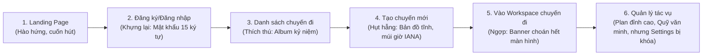
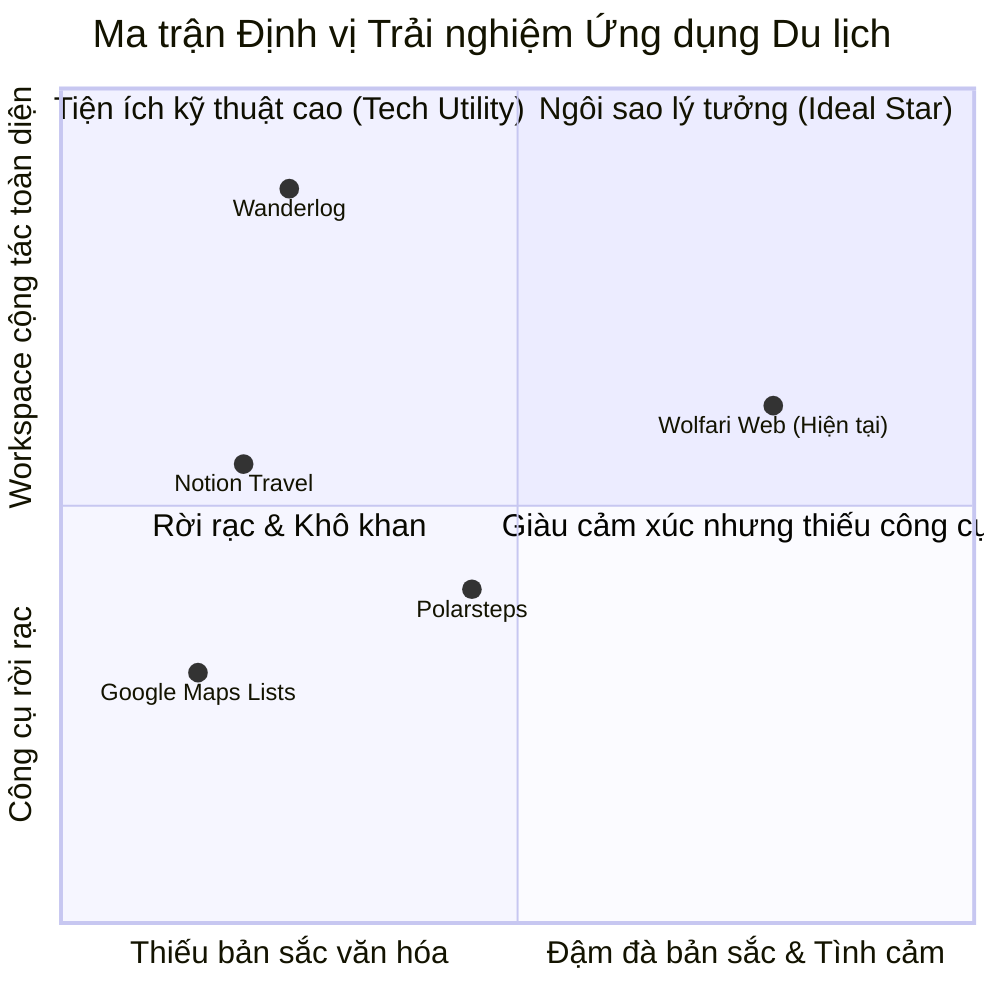
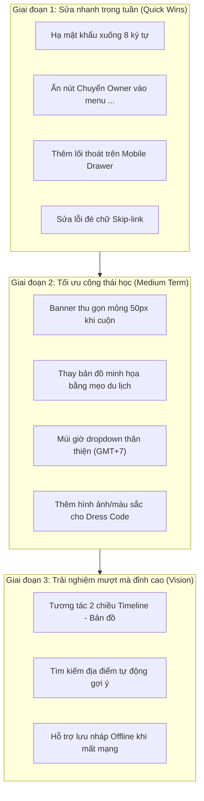

# BẢN ĐÁNH GIÁ TOÀN DIỆN & CHUYÊN SÂU GIAO DIỆN WOLFARI WEB
*Phân tích dưới lăng kính trải nghiệm con người thực tế, tâm lý học hành vi (UX Psychology), công thái học phần mềm (Software Ergonomics) và chuẩn mực thiết kế sản phẩm số (Digital Product Design)*

---

## LỜI NÓI ĐẦU: TIẾP CẬN DƯỚI GÓC NHÌN CON NGƯỜI THẬT

Khi một người dùng mở một ứng dụng lên kế hoạch du lịch như **Wolfari**, họ không tìm kiếm một bảng tính Excel hay một phần mềm quản lý công việc văn phòng (Jira, Trello). Họ đang mang trong mình:
1. **Sự háo hức, mong chờ**: Cảm xúc về một kỳ nghỉ sắp tới cùng người yêu, gia đình hoặc nhóm bạn thân sau những ngày làm việc căng thẳng.
2. **Sự lo âu, mệt mỏi tiềm ẩn**: Nỗi sợ trễ chuyến bay, quên đồ đạc, lịch trình quá dày làm kiệt sức, hay sự ngại ngùng tế nhị khi chia tiền bạc ("ai nợ ai", "thủ quỹ tính nhầm").

Một giao diện du lịch xuất sắc là giao diện **tiếp thêm năng lượng cho sự hào hứng** và **xóa tan nỗi âu lo điều phối**.

Tài liệu này không lặp lại những báo cáo kiểm thử kỹ thuật khô khan (pass/fail unit test, mã token CSS), mà soi chiếu trực tiếp vào **từng màn hình, từng hình ảnh, từng nút bấm, từng khoảng trống** để trả lời câu hỏi cốt tử: 
> *“Một con người bằng xương bằng thịt khi nhìn vào và thao tác trên giao diện này sẽ cảm thấy như thế nào?”*

---

## PHẦN I. HÀNH TRÌNH CẢM XÚC TỔNG THỂ (THE EMOTIONAL JOURNEY)

### 1. Điểm chạm đầu tiên: Cảm xúc nhen nhóm rất tốt (Aesthetic & Charm)
- **Vibe tổng thể**: Tông màu xanh biển kết hợp xanh ngọc và nắng vàng mang lại cảm giác mát mẻ, tự do của biển miền Trung (Đà Nẵng, Nha Trang, Phú Quốc).
- **Linh vật chú sói Wolfari**: Chú sói chibi cầm cuốn sổ hành trình, đội mũ phiêu lưu là một tài sản hình ảnh (brand asset) cực kỳ đắt giá. Nó biến ứng dụng từ một "công cụ vô hồn" thành một "người bạn đồng hành". Các chi tiết phong cách scrapbook (ảnh chụp polaroid kẹp giấy, ghim băng dính màu pastel, mũi tên nét đứt vẽ tay) khơi gợi lại thói quen dán nhật ký du lịch thời trẻ.

### 2. Cú va chạm thực tế: Sự giằng co phong cách và rào cản thao tác
Ngay sau ấn tượng ban đầu dễ thương, người dùng bước vào các tác vụ thực tế và bắt đầu gặp những điểm "hẫng":
- **Sự phân liệt phong cách (Visual Schizophrenia)**: Bên ngoài landing page và thẻ danh sách thì thơ mộng, thủ công (scrapbook, ảnh dán); nhưng khi bước vào bên trong chuyến đi (*Lịch trình, Quỹ nhóm, Thành viên*), giao diện đột ngột biến thành một dashboard văn phòng phẳng lì, nghiêm nghị với những khối bo góc trắng toát và các bảng biểu khô khan.
- **Bệnh "Nghiện Banner" (Banner-heavy layout)**: Trên màn hình máy tính thông thường, banner phong cảnh choán hết nửa trên màn hình. Mỗi lần chuyển tab là một lần phải cuộn chuột dài để tìm nơi bắt đầu làm việc.
- **Rào cản ngôn ngữ kỹ thuật**: Nhiều chỗ vẫn dùng ngôn ngữ của lập trình viên thay vì ngôn ngữ đời thường (ví dụ: `Asia/Ho_Chi_Minh`, `OWNER_ONLY`, `ALL_MEMBERS`, mật khẩu bắt buộc 15 ký tự).

---

## PHẦN II. SOI KỸ TỪNG MÀN HÌNH, TỪNG ẢNH & TỪNG CHI TIẾT CỤ THỂ

---

### 1. Trang chủ đón khách (Landing Page — `/`)
*(Đối chiếu hình ảnh: `home-guest-corrected-1440.png`, `768-5376.png`, `home-guest-402.png`)*

#### Cảm nhận trực quan
- **Nửa trên (Hero Section)**: Rất cuốn hút. Tiêu đề viết tay uốn lượn *"Cho những chuyến đi thật đẹp"* kết hợp với cụm ảnh polaroid phong cảnh biển tạo cảm giác muốn xách balo lên và đi ngay lập tức. Nút bấm *"Bắt đầu ngay"* màu xanh đại dương nổi bật trên nền trời xanh pastel.
- **Khối tính năng ("Tất cả những gì bạn cần trong một nơi")**: 6 icon tính năng bố trí tròn trịa, màu sắc dịu mắt. Hình chú sói đọc sách ở giữa đóng vai trò người dẫn chuyện rất duyên.

#### Hạt sạn dưới góc nhìn con người thật
1. **Mockup thiết bị gây hiểu lầm tai hại (Marketing Mismatch)**:
   - Trong khối *"Xem trước trải nghiệm của bạn"*, giao diện đặt 2 chiếc iPhone đời mới bên cạnh một chiếc laptop MacBook, kèm câu: *"Dù là trên web hay điện thoại, Wolfari luôn đồng hành cùng bạn mọi lúc, mọi nơi"*.
   - **Tâm lý người dùng**: Một người trẻ truy cập trang này trên điện thoại sẽ ngay lập tức kéo xuống tìm nút *"Tải trên App Store"* hoặc *"Tải trên Google Play"*. Nhưng thực tế sản phẩm là **Web-only**, không có app native. Việc vẽ 2 chiếc iPhone với giao diện mobile app riêng biệt tạo ra một kỳ vọng ảo, khiến người dùng cảm giác bị "hẫng nhẹ" khi phát hiện ra không có ứng dụng di động để cài đặt.
2. **Nút "Xem trước" thiếu tương tác thực**:
   - Khối *"Những hành trình đang được lưu lại"* trưng bày 4 tấm card rất đẹp: *Đà Nẵng – Hội An, Phú Quốc, Đà Lạt, Sài Gòn*.
   - **Tâm lý người dùng**: Người ta sẽ tò mò click vào xem thử lịch trình mẫu của Đà Nẵng xem chuyến đi đó ăn gì, chơi ở đâu. Nhưng hiện tại các thẻ này chỉ là ảnh chụp phẳng, không click mở xem được. Sự tò mò bị chặn đứng lại.
3. **Chân trang (Footer) cụt lủn**:
   - Ở bản dựng demo, footer chỉ có một dòng chữ xám nhạt *"UI preview · Dữ liệu minh họa"*. Không có thông tin giới thiệu đội ngũ, liên hệ, chính sách hay các liên kết mạng xã hội quen thuộc. Cảm giác trang web chưa hoàn thiện, thiếu sự an tâm về mặt bảo mật thông tin cá nhân.

---

### 2. Luồng Xác thực (Đăng nhập / Đăng ký — `/login`, `/register`)
*(Đối chiếu hình ảnh: `login-fixture-1440.png`, `register-invalid-fixture-402.png`)*

#### Cảm nhận trực quan
- Thiết kế 2 cột: Bên trái là tranh kỷ niệm với chú sói và ảnh biển, bên phải là form đăng nhập màu trắng bo góc mềm mại. Cảm giác bước vào một câu lạc bộ du lịch thân thiện chứ không phải đăng nhập vào cổng thông tin thuế.

#### Hạt sạn dưới góc nhìn con người thật
1. **Cơn ác mộng: Mật khẩu tối thiểu 15 ký tự!**
   - Hãy nhìn dòng chữ đỏ ở màn hình đăng ký: *"Mật khẩu cần từ 15 đến 128 ký tự."*
   - **Tâm lý con người**: Người dùng đang hào hứng muốn rủ bạn đi chơi, bỗng nhiên bị bắt phải nghĩ ra một mật khẩu dài ít nhất 15 chữ cái! Đây là tiêu chuẩn khắt khe thường chỉ áp dụng cho tài khoản ngân hàng hoặc hệ thống bảo mật cấp doanh nghiệp. Với một ứng dụng du lịch cho giới trẻ, quy định này sẽ khiến **trên 50% người dùng bỏ cuộc ngay tại bước đăng ký**. Tiêu chuẩn hợp lý cho con người chỉ nên là 8 ký tự.
2. **Lỗi đè chữ ngớ ngẩn trên Mobile (Skip-link Bug)**:
   - Ở màn hình `register-invalid-fixture-402.png`, một khối chữ trắng viền xanh *"Đến nội dung chính"* xuất hiện trôi lơ lửng, đè bẹp lên ô nhập "Họ và tên" và dòng "50 ký tự".
   - **Cảm giác**: Trông như một lỗi giao diện vỡ nét sơ đẳng. Người dùng phổ thông không biết đó là nút hỗ trợ người khiếm thị (accessibility skip-link), họ chỉ thấy trang web bị lỗi code đè chữ.
3. **Dòng chú thích dập tắt cảm xúc**:
   - *"Bản xem trước giao diện. Thông tin đăng nhập không được gửi và không tạo phiên truy cập thật"*. Câu này xuất hiện ngay dưới nút bấm chính. Nếu đây là sản phẩm cho người dùng thật thử nghiệm, dòng chữ này khiến họ hoang mang: *"Ủa vậy tôi đăng ký làm gì khi tài khoản không có thật?"*.

---

### 3. Danh sách chuyến đi của tôi (`/trips`)
*(Đối chiếu hình ảnh: `list-fixture-1440.png`)*

#### Cảm nhận trực quan
- **Tuyệt đẹp và đầy cảm hứng**: Đây là một trong những màn hình làm tốt nhất phong cách "sổ tay lữ hành".
- Các tấm card chuyến đi được thiết kế như tấm bưu thiếp hoặc trang nhật ký với viền giấy ấm áp, bức ảnh phong cảnh đại diện, ngày đi rõ ràng, kèm icon vương miện cho *"Chủ chuyến"* và nhãn *"Thành viên"*.
- Banner phía trên có chú sói bay cùng máy bay giấy và câu nói dễ thương: *"Việt Nam còn nhiều nơi để khám phá!"*.

#### Hạt sạn dưới góc nhìn con người thật
1. **Nút "+ Tạo chuyến đi" bị "lạc lõng"**:
   - Nút hành động quan trọng nhất trang lại nằm tít góc trên bên phải của banner tranh vẽ, nền xanh đậm chìm vào nền trời xanh lơ.
   - Khi mắt người dùng quét theo chữ F tự nhiên (từ góc trái sang phải rồi xuống dưới), họ dễ bỏ qua nút này và nhìn thẳng vào thanh tìm kiếm bên dưới.
2. **Thanh tìm kiếm và bộ lọc quá dài**:
   - Thanh search, dropdown "Vai trò", "Thời gian", nút "Bộ lọc", cùng 5 tab trạng thái (*Tất cả, Sắp tới, Đang diễn ra, Đã kết thúc, Đã lưu trữ*) và dropdown "Sắp xếp" tạo thành một cụm điều khiển tới **3 tầng thanh công cụ**.
   - Với một người dùng bình thường chỉ có từ 2 đến 5 chuyến đi trong năm, bộ công cụ lọc này là quá thừa thãi và gây rối mắt (over-engineered).
3. **Nút tim "Yêu thích" gây khó hiểu**:
   - Ở góc dưới mỗi ảnh thẻ có một icon trái tim viền trắng. Khi nhìn thấy tim, người ta nghĩ ngay: *"Bấm tim để làm gì? Lưu chuyến đi yêu thích hay ai thả tim cho chuyến đi này?"*. Nhưng khi tương tác không có phản hồi số lượng tim hay danh mục lọc riêng cho mục yêu thích.

---

### 4. Màn hình Tạo chuyến đi mới (`/trips/new`)
*(Đối chiếu hình ảnh: `gateway-create-1440x960.png`, `gateway-success-1440.png`)*

#### Cảm nhận trực quan
- Bố cục 2 cột cân đối: Bên trái là biểu mẫu nhập liệu, bên phải là khung bản đồ phụ trợ.
- **Khoảnh khắc xuất sắc**: Hộp thoại popup *"Chuyến đi đã sẵn sàng"* (`gateway-success-1440.png`) với hình ảnh chú sói nháy mắt, vẫy tay chào chào mừng hành trình mới. Đây là một điểm chạm cảm xúc (delight moment) cực kỳ tốt, đem lại cảm giác thành tựu ngay lập tức.

#### Hạt sạn dưới góc nhìn con người thật
1. **Cột bản đồ bên phải: "Treo đầu dê bán thịt chó"**:
   - Cột bên phải chiếm gần nửa màn hình hiển thị một khung bản đồ vẽ cách điệu, nhưng bên dưới lại ghi:  
     *"Bản đồ điểm đến. Không cần chọn điểm đến để bắt đầu chuyến đi... Chưa hỗ trợ chọn điểm đến khi tạo chuyến đi. Bản đồ ở đây chỉ là hình minh họa."*
   - **Tâm lý con người**: Người dùng sẽ tự hỏi: *"Nếu không dùng được thì bày ra đây làm gì cho chật màn hình?"*. Cảm giác giống như bước vào một nhà hàng sang trọng nhưng bồi bàn bảo món trên menu chỉ in cho đẹp chứ bếp không nấu.
   - **Giải pháp con người**: Nếu chưa có dữ liệu bản đồ, hãy thay cột phải bằng: Gợi ý các điểm check-in hot nhất mùa này, thời tiết dự kiến, hoặc các câu quote truyền cảm hứng du lịch.
2. **Múi giờ gõ tay thô kệch**:
   - Ô Múi giờ hiển thị chữ: `Asia/Ho_Chi_Minh` kèm ghi chú *"Ví dụ: Asia/Ho_Chi_Minh"*.
   - **Tâm lý con người**: Đây là tư duy của coder cơ sở dữ liệu. Người dùng phổ thông ở Việt Nam chỉ biết "Giờ Hà Nội" hoặc "GMT+7". Việc bắt họ nhìn hoặc nhập một chuỗi ký tự máy tính có dấu gạch dưới làm giảm đi sự thân thiện của ứng dụng.

---

### 5. Bảng Tổng quan chuyến đi (`/trips/:id`)
*(Đối chiếu hình ảnh: `overview-fixture-1440.png`, `overview-fixture-402.png`)*

#### Cảm nhận trực quan
- Tấm ảnh bìa toàn cảnh thành phố biển (Đà Nẵng – Hội An) cắt góc lượn sóng màu nước rất nghệ thuật.
- Có 4 thẻ tóm tắt nhanh: *Lịch trình ngày đầu, Thời tiết, Ngân sách/Quỹ nhóm, Tiến độ Packing list*. Thanh tiến độ 8/12 món (67%) màu xanh lá tạo cảm giác rõ ràng, trực quan.

#### Hạt sạn dưới góc nhìn con người thật
1. **Banner chiếm quá nhiều không gian (The Fold Problem)**:
   - Trên màn hình 1440×960 hoặc laptop 1366×768, sau khi nhìn xong thanh điều hướng trên cùng, breadcrumb và tấm banner to, người dùng phải cuộn chuột xuống thì mới thấy được danh sách hoạt động ngày 1.
2. **Cảm giác hụt hẫng vì các thẻ rỗng**:
   - Thẻ *Thời tiết*: "Chưa khả dụng". Thẻ *Ngân sách/Quỹ nhóm*: "Chưa khả dụng". Thẻ *Bản đồ hành trình*: "Bản đồ hành trình sẽ xuất hiện khi có dữ liệu địa điểm". Thẻ *Theo dõi giá vé*: "Chưa khả dụng".
   - **Cảm giác con người**: Trong tổng số 6 khối nội dung trên màn hình, có tới 4 khối thông báo "Chưa khả dụng" hoặc trống trơn. Người dùng cảm thấy như đang đứng trong một ngôi nhà xây dở chỉ có mỗi khung cửa sổ.
3. **Thẻ góc dưới phải vô dụng**:
   - Thẻ *"Mỗi chuyến đi là một câu chuyện..."* với hình vẽ sóng biển màu nước trông rất thơ mộng, nhưng nó chiếm nguyên một góc phải mà không mang lại bất kỳ giá trị thông tin hay hành động nào. Khi quản lý một chuyến đi thực tế, người ta cần công cụ, không cần một tấm bưu thiếp chiếm chỗ.

---

### 6. Trái tim của ứng dụng: Màn hình Lịch trình (`/trips/:id/plan`)
*(Đối chiếu hình ảnh: `20-236.png`, `439-2028.png`, `439-2497.png`, `plan-1366x520.png`)*

#### Cảm nhận trực quan
- **Tính năng đỉnh cao nhất của Wolfari**: Hãy nhìn vào thiết kế trục thời gian (Timeline) ở hình `20-236.png`:
  - Mỗi hoạt động có số thứ tự tròn xanh (1, 2, 3, 4), nối với nhau bằng đường line dọc.
  - Khung giờ rõ ràng: `08:00 - 10:30`, `11:30 - 13:00`.
  - Icon phân loại hoạt động (núi = tham quan, dao nĩa = ăn uống, dù = bãi biển, đền chùa = di tích).
  - **Điểm sáng giá nhất**: Các nhãn xe ô tô ở giữa 2 chặng:  
    `🚗 20 phút di chuyển (12 km)`  
    `🚗 15 phút di chuyển (7 km)`  
  - Đây chính là điều mà mọi người lên lịch trình cần nhất: Họ không chỉ muốn biết đi đâu, mà muốn biết **từ điểm A sang điểm B mất bao lâu để không bị trễ giờ ăn trưa hay bắt chuyến bay!**
- Hàng 4 chỉ số trên đỉnh: *6 hoạt động, 6 địa điểm, ~9h15 trải nghiệm, 1h20 di chuyển (tổng)* mang lại một bức tranh toàn cảnh cực kỳ khoa học.

#### Hạt sạn dưới góc nhìn con người thật
1. **Thảm họa hiển thị trên màn hình laptop thấp (`plan-1366x520.png`)**:
   - Khi nhìn vào ảnh chụp thực tế trên màn hình chiều cao 520px: Toàn bộ danh sách hoạt động **hoàn toàn biến mất khỏi tầm mắt**!
   - Tất cả những gì người dùng thấy chỉ là: Navbar $\to$ Banner phong cảnh $\to$ Tiêu đề Lịch trình $\to$ Dải tab ngày. Người dùng thậm chí không biết là có danh sách các hoạt động bên dưới nếu không tiện tay cuộn chuột.
2. **Cạnh tranh diện tích khi mở bản đồ hoặc kho hoạt động (`439-2028.png`, `439-2497.png`)**:
   - Khi người dùng bấm nút *"Hiện bản đồ"* hoặc mở bảng *"Đã chọn · Chưa xếp lịch"*, màn hình bị chia đôi (Split Panel).
   - Lúc này, cột lịch trình bên trái bị co hẹp lại, các ảnh thumbnail địa điểm bị ép nhỏ, tên địa chỉ bị ngắt dòng lộn xộn. Trải nghiệm đọc lịch trình đột ngột trở nên bí bách.
3. **Nút "Thêm ngày" nằm ngang hàng với tab ngày**:
   - Tab Ngày 1, Ngày 2, Ngày 3 có nút `+ Thêm ngày` nằm ngay bên cạnh. Điều này rất tiện, nhưng nếu chuyến đi dài 10 ngày thì thanh tab này sẽ tràn màn hình và buộc người dùng phải cuộn ngang – một thao tác rất khó chịu trên chuột máy tính bàn.
4. **Cửa sổ soạn thảo hoạt động (Centered Activity Modal)**:
   - Khi bấm "Thêm hoạt động" hoặc sửa một hoạt động, cửa sổ modal hiện giữa màn hình (rộng 560px).
   - **Vấn đề ngắt quãng dòng tư duy (Context Disconnect)**: Trường chọn "Địa điểm" bên trong form chỉ là một `<select>` dropdown chứa các địa điểm đã lưu từ trước. Nếu người dùng chợt nhớ ra quán cà phê muốn ghé, họ **không thể gõ tìm và thêm địa điểm mới ngay trong form này**! Họ buộc phải hủy form, quay ra ngoài tìm cách thêm địa điểm vào kho, rồi mới quay lại tạo hoạt động. Thao tác này gây ức chế lớn cho người dùng thực tế.

---

### 7. Quản lý Quỹ nhóm (`/trips/:id/fund`)
*(Đối chiếu hình ảnh: `528-4683.png`, `528-5059.png`)*

#### Cảm nhận trực quan
- **Rất văn minh và minh bạch**: Vấn đề tiền bạc trong các chuyến đi chơi nhóm ở Việt Nam luôn là chuyện nhạy cảm. Wolfari đã giải quyết điều này bằng 4 khối số to, rõ ràng:
  - *Ngân sách mục tiêu*: **9.000.000đ**
  - *Đóng góp đã ghi nhận*: **7.000.000đ**
  - *Đã chi từ quỹ*: **6.250.000đ**
  - *Quỹ có thể sử dụng*: **750.000đ** (xanh ngọc an tâm).
- Bảng chi tiết từng thành viên (*Trang Nguyễn đã nộp, Hà đã nộp, Quyên thiếu 500.000đ*) được thể hiện với màu cam cảnh báo tinh tế, không mang tính phán xét nhưng đủ rõ để nhắc nhở.

#### Hạt sạn dưới góc nhìn con người thật
1. **Dòng tuyên bố từ chối trách nhiệm gây hoang mang**:
   - Dòng chữ: *"Wolfari chỉ ghi nhận và đối chiếu dữ liệu; không giữ hoặc chuyển tiền thật"* nằm ngay cạnh nút trạng thái quỹ.
   - Về mặt pháp lý là đúng, nhưng về mặt thiết kế, vị trí đặt dòng này hơi lơ lửng, tạo cảm giác app đang "chối bỏ trách nhiệm" ngay khi người dùng vừa mở trang tài chính.
2. **Cột tạo đợt đóng góp bên phải chiếm chỗ vô ích**:
   - Khung "Tạo đợt đóng góp" nằm cố định bên phải màn hình. Nhưng trong cả chuyến đi, người ta chỉ tạo đợt đóng góp 1 hoặc 2 lần, trong khi họ phải tra cứu danh sách thu chi hàng chục lần mỗi ngày.
   - Việc để form này chiếm vĩnh viễn 1/3 chiều ngang màn hình làm bảng danh sách thu chi bị ép chật chội một cách không cần thiết.

---

### 8. Thành viên & Lời mời (`/trips/:id/members`)
*(Đối chiếu hình ảnh: `768-7492.png`, `475-2294.png`, `299-2010.png`)*

#### Cảm nhận trực quan
- Màn hình nhận lời mời tham gia (`299-2010.png`): Chú sói cầm sách, nền núi mờ, thiệp mời ghi rõ tên người mời (Trang Nguyễn) và vai trò. Rất trang nhã và tạo sự tin cậy.

#### Hạt sạn dưới góc nhìn con người thật
1. **Quả bom nổ chậm: Nút "Chuyển Owner" ở khắp mọi nơi!**
   - Hãy nhìn vào danh sách bạn bè (`768-7492.png`): Cạnh tên mỗi người bạn (Hà, Quyên, Tân), nút hành động duy nhất và to nhất là nút **"Chuyển Owner"**!
   - **Tâm lý con người**: Trong một chuyến đi chơi, việc chuyển quyền trưởng nhóm là chuyện cực kỳ hiếm khi xảy ra. Người ta cần những nút như: *"Nhắn tin"*, *"Xem các khoản đã đóng"*, hoặc cùng lắm là *"Xóa khỏi nhóm"*. Việc bày nút "Chuyển Owner" ngay mặt tiền tạo tâm lý bất an cho trưởng nhóm vì sợ lỡ tay bấm nhầm là mất quyền quản lý chuyến đi!
2. **Cột phải như một văn bản pháp lý khô khan**:
   - Toàn bộ cột bên phải là các định nghĩa: *Owner là gì, Fund Holder là gì, PlanEditPolicy là gì, Khi chuyển Owner thì điều gì xảy ra...*
   - Một nhóm bạn rủ nhau đi Đà Lạt không phải là một công ty cổ phần tổ chức đại hội cổ đông. Cách viết và trình bày này quá nặng tính pháp lý và kỹ thuật, tạo khoảng cách tâm lý xa lạ với người dùng thông thường.

---

### 9. Cài đặt chuyến đi (`/trips/:id/settings`)
*(Đối chiếu hình ảnh: `settings-fixture-1440.png`, `settings-edit-fixture-1440.png`)*

#### Hạt sạn dưới góc nhìn con người thật: "Sự bất lực của nút Chỉnh sửa"
- Khi người dùng vào trang Cài đặt và bấm vào nút **"Chỉnh sửa thông tin"**, họ kỳ vọng sửa được ngày đi hoặc điểm đến.
- Nhưng nhìn vào ảnh `settings-edit-fixture-1440.png`, một loạt ô bị tô xám và hiện dòng chữ đỏ/xám lặp đi lặp lại:
  - *Điểm đến: Chưa hỗ trợ chỉnh sửa trong phiên bản này.*
  - *Ngày bắt đầu: Chưa hỗ trợ chỉnh sửa trong phiên bản này.*
  - *Ngày kết thúc: Chưa hỗ trợ chỉnh sửa trong phiên bản này.*
  - *Ngân sách dự kiến: Chưa hỗ trợ chỉnh sửa trong phiên bản này.*
- **Cảm giác con người**: Sự thất vọng tràn trề! Người dùng sẽ bực mình thốt lên: *"Nếu cái gì cũng không cho sửa thì các bạn sinh ra nút Chỉnh sửa này để làm gì?"*. 
- Nếu phiên bản hiện tại Backend chỉ cho sửa Tên chuyến đi và Mô tả, thì **chỉ nên hiển thị 2 ô đó để nhập**, còn các thông tin khác hãy để dạng nhãn tĩnh (read-only label), tránh bày ra ô input rồi khóa lại kèm thông báo từ chối.

---

### 10. Danh sách đồ đạc (Packing List — `/trips/:id/packing`)
*(Đối chiếu mã nguồn: `PackingPage.tsx`, `PackingPage.module.css`)*

#### Cảm nhận trực quan
- Phân nhóm đồ đạc thông minh: *Giấy tờ tùy thân, Quần áo, Thuốc men y tế, Đồ điện tử, Đồ dùng cá nhân*.
- Có thanh tiến độ hoàn thành (*8/12 món - 67%*). Checkbox tích chọn tạo cảm giác nhẹ nhõm và an tâm rằng mình không quên thứ gì quan trọng ở nhà.

#### Hạt sạn dưới góc nhìn con người thật
- **Sự phân biệt đối xử giữa Preview vs Gateway**: Trong mã nguồn, ở chế độ Gateway thật, danh sách đồ đạc bị hạn chế quyền chỉnh sửa (chủ yếu là read projection). Người dùng không thể tự do thêm món đồ cá nhân đột xuất (ví dụ: "sạc máy ảnh Sony", "thuốc say xe của mẹ"). Một danh sách đồ chuẩn bị mà không cho người đi thêm đồ của riêng mình thì sẽ nhanh chóng bị bỏ xó để quay về ghi chú trên điện thoại (Apple Notes/Google Keep).
- **Thiếu phân công đồ chung vs đồ riêng**: Đi nhóm luôn có những món đồ dùng chung (bộ cờ cá ngựa, loa bluetooth, kem chống nắng dùng chung, bàn ủi mini). Giao diện chưa làm nổi bật được ai chịu trách nhiệm mang đồ gì cho cả nhóm.

---

### 11. Trang phục du lịch (Dress Code — `/trips/:id/dress-code`)
*(Đối chiếu mã nguồn: `GatewayDressCodePage.tsx`, `DressCodePage.module.css`)*

#### Cảm nhận trực quan
- **Ý tưởng cực kỳ bắt trend giới trẻ**: Nhóm bạn trẻ Việt Nam đi du lịch (nhất là phái nữ) cực kỳ quan tâm đến việc mặc gì: ngày 1 mặc tone be/trắng chụp ảnh cafe, ngày 2 mặc đồ bơi, ngày 3 đi chùa phải mặc đồ kín đáo lịch sự. Tính năng phân loại *Cả chuyến / Theo ngày / Theo hoạt động* đánh trúng tâm lý này.

#### Hạt sạn dưới góc nhìn con người thật
- **Văn bản khô khan, thiếu hình ảnh (No Moodboard / Visual Palette)**: Điểm mấu chốt của trang phục là **màu sắc và phong cách thị giác**. Nhưng giao diện hiện tại toàn bộ là các dòng chữ mô tả dài ngoằng. Người dùng không thấy được bảng màu chủ đạo (Color Swatches: ví dụ mã màu pastel `#f8e4d8`, `#317c89`) và không có chỗ để đính kèm ảnh outfit mẫu. Nó biến một tính năng thời trang hào hứng thành một bảng nội quy trường học.

---

### 12. Theo dõi giá vé máy bay (Price Watch — `/trips/:id/price-watch`)
*(Đối chiếu mã nguồn: `RuntimePriceWatchPage.tsx`, `RuntimePriceWatchPage.module.css`)*

#### Cảm nhận trực quan
- Biểu đồ theo dõi giá vé theo thời gian, phát hiện giá vé tăng hay giảm để chốt vé đúng thời điểm. Rất hữu ích cho các chuyến bay nội địa Việt Nam (Hà Nội/Sài Gòn đi Đà Nẵng, Phú Quốc).

#### Hạt sạn dưới góc nhìn con người thật
- **Cú sốc múi giờ UTC**: Dữ liệu lịch sử quan sát giá đang hiển thị theo thời gian gốc UTC hoặc định dạng ngày tháng thô của máy tính. Người dùng Việt Nam nhìn vào giờ bay `01:30 UTC` sẽ bị nhầm lẫn nghiêm trọng sang giờ bay thực tế ở Việt Nam (`08:30 GMT+7`).
- **Gắn nhãn `MOCK_FLIGHT`**: Dữ liệu giả lập ghi chữ MOCK_FLIGHT gây bối rối cho người dùng phổ thông không hiểu thuật ngữ phần mềm.

---

### 13. Hộp thư thông báo (Notification Inbox Drawer)
*(Đối chiếu mã nguồn: `NotificationInbox.tsx`, `Notifications.module.css`)*

#### Cảm nhận trực quan
- Bấm chuông thông báo ở thanh trên cùng, một ngăn kéo trượt ra từ bên phải rất gọn gàng.
- Phân loại rõ thông báo: Lời mời tham gia chuyến đi, cập nhật lịch trình, biến động giá vé, nhắc nhở đóng quỹ.

#### Hạt sạn dưới góc nhìn con người thật
- **Thiếu thao tác trực tiếp (Inline Action)**: Khi nhận được thông báo *"Trang Nguyễn đã mời bạn tham gia Đà Nẵng 3N2Đ"*, người dùng muốn bấm nút "Đồng ý" ngay trên thông báo đó. Nhưng hiện tại họ phải bấm vào thông báo để chuyển hướng sang một trang khác rồi mới được thao tác. Điều này làm tăng số bước nhấp chuột không cần thiết.

---

### 14. Menu Mobile (Drawer 402px — `trip-drawer-402.png`, `not-found-402.png`)
* **Bị "nhốt" trong chuyến đi (No Exit)**: Menu mobile chỉ liệt kê 9 mục của chuyến đi hiện tại. Hoàn toàn **không có nút quay về "Chuyến đi của tôi"** và **không có thông tin tài khoản / đăng xuất**. Người dùng bị mắc kẹt hoàn toàn, muốn đổi sang chuyến đi khác phải gõ lại URL trình duyệt.
* **Trang 404 lạnh lùng**: Chỉ có dòng chữ báo lỗi khô khốc. Một ứng dụng có linh vật đáng yêu như Wolfari lại thiếu hình ảnh chú sói gãi đầu ngơ ngác *"Úi, lạc đường rồi!"* là một sự bỏ phí cảm xúc rất đáng tiếc.

---

## PHẦN III. PHÂN TÍCH CÔNG THÁI HỌC CỦA TỪNG COMPONENT CỐT LÕI (CORE COMPONENT ERGONOMICS)

| Component | Điểm mạnh hiện tại | Điểm yếu công thái học (Ergonomics Flaws) |
| :--- | :--- | :--- |
| **`Button`** | Đủ variants (*primary, secondary, outline, plain, destructive*). Chiều cao đạt chuẩn 44px dễ bấm trên cảm ứng. | Nút chính dùng màu gradient hoặc `#006b92` rất đẹp, nhưng nút thứ cấp (*secondary/outline*) viền quá mảnh (`#cdebf7`), đặt trên nền sáng gần như "vô hình". Trạng thái loading đôi khi làm mất nhãn văn bản khiến chiều rộng nút bị giật (Layout Shift - CLS). |
| **`Drawer`** | Hiệu ứng trượt mượt mà, Radix UI xử lý bẫy tiêu điểm (focus trap) và phím Escape rất chuẩn mực. | Ngăn kéo mobile (`trip-drawer-402.png`) chiếm 300px trên màn hình 402px, phần tối mờ (backdrop) còn lại chỉ 102px, quá hẹp để người dùng ngón tay cái chạm bấm ra ngoài để đóng drawer. |
| **`Modal Dialog`** | Căn giữa màn hình chuẩn mực theo Figma D18 (`560px`). Nút Lưu/Hủy dính ở đáy (`sticky bottom`). | Trên màn hình laptop chiều cao 520px - 600px, modal dài quá sinh ra thanh cuộn dọc bên trong. Nút bấm dính đáy che mất trường nhập cuối cùng nếu không có lớp đệm (padding-bottom) đủ lớn. |
| **`Input / Select`** | Có icon trước/sau, nhãn hiển thị rõ ràng, viền focus xanh đậm dễ nhận biết. | Trường chọn `<Select>` trong toàn bộ ứng dụng vẫn dùng dropdown gốc của trình duyệt (native select). Trông rất thô sơ, không ăn nhập với ngôn ngữ thiết kế bo tròn pastel của sản phẩm. |
| **`SplitPanel`** | Cho phép chia đôi màn hình giữa Lịch trình và Bản đồ/Kho địa điểm. Có nhớ vị trí kéo thả. | Vạch kéo (divider handle) quá mỏng (chỉ 2-4px), người dùng chuột rất khó rê trúng điểm để kéo; trên màn hình cảm ứng hầu như không kéo được. |

---

## PHẦN IV. SO SÁNH VỚI CÁC CHUẨN MỰC QUỐC TẾ (COMPETITOR BENCHMARKING)

### 1. Điểm Wolfari vượt trội so với thế giới (Wanderlog, Polarsteps, TripIt):
1. **Giải quyết xuất sắc bài toán văn hóa nhóm của người Việt**:
   - Các ứng dụng phương Tây (như Wanderlog) thường rất yếu ở khâu **Quỹ nhóm (Group Fund)**. Ở Việt Nam, văn hóa đi chơi là "bầu thủ quỹ", nộp tiền một cục hoặc chia đều các bữa ăn. Tính năng Quỹ nhóm của Wolfari với 4 chỉ số và danh sách nghĩa vụ từng người là một "đặc sản" cực mạnh.
2. **Linh vật và tính gắn kết cảm xúc (Emotional Mascot)**:
   - Trong khi Wanderlog hay TripIt trông như phần mềm quản lý kho bãi, Wolfari có chú sói phiêu lưu dẫn lối, mang lại sự thư giãn và nụ cười cho người dùng.

### 2. Điểm Wolfari cần học hỏi từ các đối thủ lớn:
1. **Khả năng tương tác bản đồ 2 chiều (Bidirectional Map Interaction của Wanderlog)**:
   - Ở Wanderlog, khi rê chuột vào hoạt động số 1 trên timeline, điểm số 1 trên bản đồ nảy lên (bounce animation); click vào điểm trên bản đồ thì timeline tự cuộn đến đúng hoạt động đó. Wolfari hiện tại bản đồ và timeline vẫn còn rời rạc.
2. **Thêm địa điểm thông minh (Smart Place Autocomplete)**:
   - Các app quốc tế tích hợp Google Places API, người dùng chỉ cần gõ "Bánh xèo Bà Dưỡng" là tự ra địa chỉ, ảnh đại diện, giờ mở cửa. Wolfari hiện tại đòi hỏi thêm thủ công khá nhiều bước.

---

## PHẦN V. BẢNG TỔNG KẾT & CHẤM ĐIỂM TRẢI NGHIỆM CON NGƯỜI

| Tiêu chí | Điểm (Thang 10) | Nhận xét chân thật |
| :--- | :---: | :--- |
| **Ấn tượng thị giác (Visual Appeal)** | **8.5** | Màu sắc đẹp, linh vật dễ thương, phong cách scrapbook rất có hồn và gợi cảm hứng xê dịch. |
| **Cấu trúc thông tin (Information Architecture)** | **8.0** | Chia tách các module chuyến đi (Lịch trình, Quỹ, Thành viên, Đồ đạc) rất khoa học và logic. |
| **Tính tiện dụng tác vụ (Task Ergonomics)** | **6.5** | Banner quá to đẩy nội dung xuống dưới fold; form tạo chuyến và cài đặt còn gượng gạo; nhiều khoảng trống thừa. |
| **Độ chân thực & Tin cậy (Truthfulness)** | **8.5** | Rất trung thực, không dùng số liệu ảo để lừa người dùng; tuy nhiên cần khéo léo hơn để không biến thành "cảm giác dang dở". |
| **Công thái học Mobile (Mobile Usability)** | **6.0** | Thiếu đường dẫn thoát khỏi chuyến đi trên menu mobile; lỗi đè chữ skip-link; bảng biểu chật chội. |
| **Tâm lý học hành vi (UX Psychology)** | **6.5** | Mật khẩu 15 ký tự gây ức chế; nút Chuyển Owner gây hoang mang; các thông báo từ chối sửa gây hụt hẫng. |
| **TỔNG KẾT TOÀN DIỆN** | **7.3 / 10** | **Một sản phẩm có tiềm năng rất lớn về mặt cảm xúc và ý tưởng, nhưng cần gọt giũa nhiều về mặt công thái học và tinh tế hóa trải nghiệm người dùng.** |

---

## PHẦN VI. LỘ TRÌNH 3 GIAI ĐOẠN TỐI ƯU HÓA GIAO DIỆN

### 1. Giai đoạn 1: Sửa nhanh giải tỏa ức chế (Quick Wins — 1 đến 2 ngày)
1. **Hạ chuẩn mật khẩu xuống 8 ký tự**: Xóa bỏ rào cản 15 ký tự ngay lập tức để người dùng dễ dàng tạo tài khoản.
2. **Ẩn nút "Chuyển Owner"**: Thay bằng nút `...` (Menu hành động), đưa tính năng chuyển trưởng nhóm vào trong với màu đỏ cảnh báo.
3. **Thêm lối thoát trên Drawer Mobile**: Đặt liên kết `⬅ Chuyến đi của tôi` và thông tin `Tài khoản / Đăng xuất` vào menu mobile.
4. **Sửa lỗi đè chữ Skip-link**: Ẩn nút "Đến nội dung chính" ra khỏi tầm nhìn thị giác thông thường bằng kỹ thuật CSS `sr-only` chuẩn.

### 2. Giai đoạn 2: Nâng tầm công thái học (Medium Term — 1 đến 2 tuần)
1. **Banner thu gọn khi cuộn (Sticky Compact Header)**: Khi cuộn xuống xem Lịch trình hoặc Quỹ, banner ảnh tự co thành thanh mỏng 50px. Nhường 85% diện tích màn hình laptop cho nội dung thao tác.
2. **Thay thế bản đồ minh họa ở trang Tạo chuyến đi**: Đổi khung bản đồ tĩnh thành danh sách các địa điểm check-in gợi ý hoặc các câu nói truyền cảm hứng du lịch.
3. **Thân thiện hóa ô Múi giờ**: Thay input gõ tay `Asia/Ho_Chi_Minh` bằng dropdown `(GMT+07:00) Giờ Việt Nam / Hà Nội`.
4. **Thêm chất liệu thời trang cho Dress Code**: Bổ sung các ô bảng màu (color swatches) để nhóm bạn dễ thống nhất mặc tone gì chụp ảnh đẹp.

### 3. Giai đoạn 3: Trải nghiệm gắn kết đỉnh cao (Vision)
1. **Tương tác 2 chiều Bản đồ - Lịch trình**: Rê chuột đến đâu trên timeline, bản đồ phóng to và phát sáng điểm đó đến đấy.
2. **Tự động hóa địa điểm**: Gõ tên quán là tự nhận diện địa chỉ và ảnh đại diện.
3. **Linh vật tương tác (Interactive Mascot)**: Chú sói Wolfari biết đổi biểu cảm khi người dùng hoàn thành 100% đồ đạc (nhảy múa chúc mừng) hoặc khi lịch trình bị trùng giờ (sói làm mặt lo lắng nhắc nhở).

---
*Báo cáo được lưu trữ trực tiếp tại `DANH_GIA_CHI_TIET_GIAO_DIEN.md` trong thư mục gốc của dự án. Không áp dụng thay đổi mã nguồn hoặc commit.*
