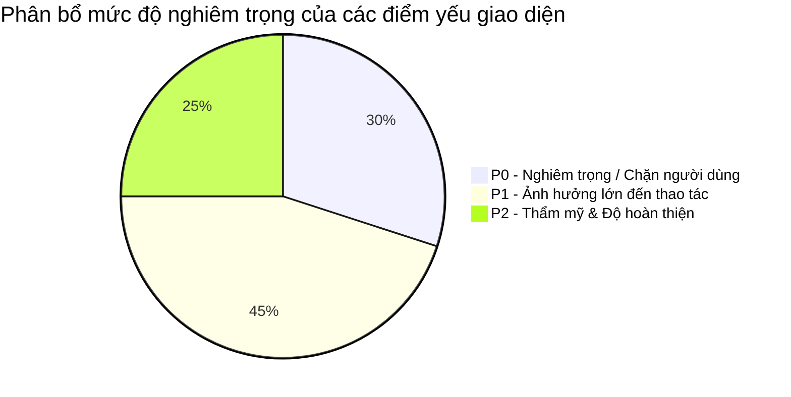
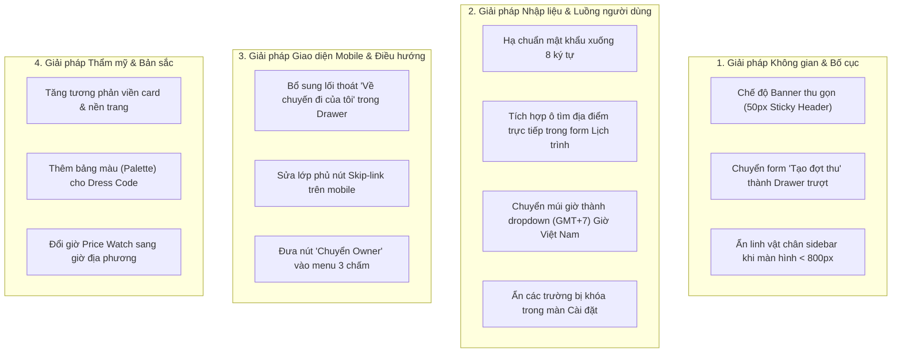
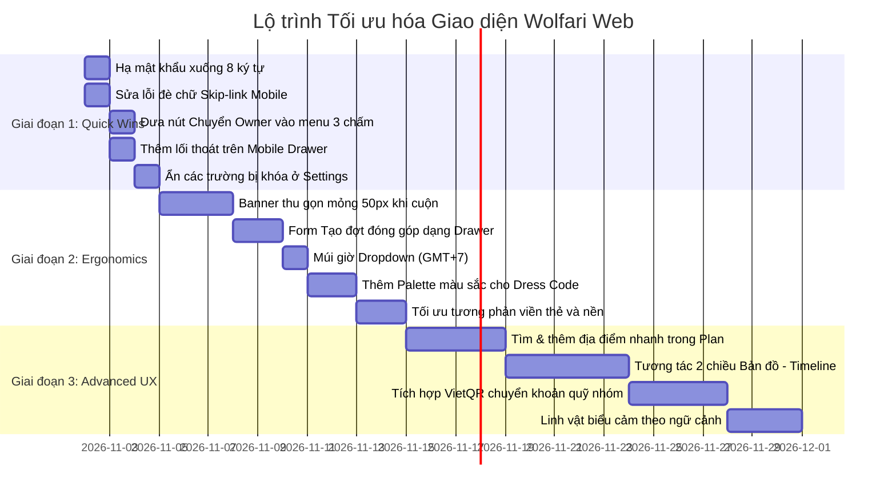

# BÁO CÁO PHÂN TÍCH TOÀN DIỆN: CÁC ĐIỂM YẾU GIAO DIỆN & LỘ TRÌNH CẢI THIỆN WOLFARI WEB
*Tập trung phân tích các lỗ hổng trải nghiệm (UX Pain Points), lỗi công thái học (Ergonomics Flaws), rào cản tâm lý người dùng và đề xuất lộ trình khắc phục theo mức độ ưu tiên.*

---

## TÓM TẮT ĐIỀU HÀNH: 3 "CĂN BỆNH" LỚN NHẤT CỦA GIAO DIỆN HIỆN TẠI

Sau khi rà soát toàn bộ hệ thống giao diện, mã nguồn frontend, các màn hình thử nghiệm thực tế và đối chiếu với bản thiết kế Figma gốc, giao diện Wolfari Web đang mắc phải **3 căn bệnh cốt lõi**:

1. **Bệnh "Nghiện Banner" & Lãng phí không gian (The Fold & Real Estate Crisis)**:
   - Các màn hình làm việc chính (*Tổng quan, Lịch trình, Quỹ nhóm, Thành viên, Đồ đạc, Cài đặt*) đều bị tấm banner phong cảnh 150px kết hợp với Header 76px và Breadcrumb chiếm tới **hơn 50% chiều cao màn hình laptop phổ thông (1366×768 / 1440×900)**.
   - Hậu quả: Không gian hiển thị nội dung thực tế chỉ còn lại khoảng 200–250px. Người dùng vừa vào trang là lập tức phải cuộn chuột dài mới thấy được nơi bắt đầu làm việc.
2. **Sự gián đoạn dòng tư duy & Ức chế nhập liệu (Cognitive Friction & Dead-ends)**:
   - Nhiều tính năng tạo ra sự ức chế tâm lý nặng nề: Mật khẩu bắt buộc 15 ký tự; nút "Chỉnh sửa" chuyến đi mở ra 4/5 trường bị khóa; form tạo hoạt động không cho phép gõ thêm địa điểm mới; khung bản đồ chiếm 40% màn hình chỉ để ghi "chưa hỗ trợ".
3. **Sự lệch pha giữa Vibe Sổ tay (Scrapbook) và Dashboard Văn phòng (Sterile SaaS)**:
   - Ngoài trang chủ và danh sách thẻ thì đầy cảm xúc lữ hành, nhưng khi bước vào bên trong chuyến đi thì các bảng biểu, quyền hạn, chính sách bảo mật bị thể hiện như văn bản pháp lý của một phần mềm quản trị doanh nghiệp khắt khe.

---

## PHẦN I. DANH MỤC 20 ĐIỂM YẾU CHI TIẾT (PHÂN THEO MỨC ĐỘ ƯU TIÊN)

---

### NHÓM P0: CÁC ĐIỂM NGHẼN NGHIÊM TRỌNG (CRITICAL BLOCKERS)
*Những điểm yếu trực tiếp làm đứt gãy trải nghiệm, khiến người dùng bỏ cuộc hoặc gây rủi ro thao tác sai lầm.*

| STT | Vị trí / Component | Điểm yếu cụ thể | Hậu quả tâm lý & Hành vi |
| :---: | :--- | :--- | :--- |
| **01** | **Trang Đăng ký (`/register`)** | **Mật khẩu bắt buộc từ 15 đến 128 ký tự**. | **Tỷ lệ bỏ rơi cực cao (>50%)**: Người dùng đang háo hức rủ bạn đi chơi, bị ép nghĩ ra mật khẩu 15 ký tự sẽ lập tức đóng tab. Đây là quy chuẩn ngân hàng/quân sự, hoàn toàn sai lệch với ứng dụng du lịch B2C cho giới trẻ. |
| **02** | **Mobile Drawer (Menu 402px)** | **Bị "nhốt" bên trong chuyến đi (No Exit)**: Menu mobile khi mở bên trong một chuyến đi chỉ liệt kê 9 tab nội bộ. Hoàn toàn **không có nút quay về "Chuyến đi của tôi"** và **không có thông tin tài khoản / Đăng xuất**. | Người dùng bị mắc kẹt hoàn toàn trên điện thoại. Muốn đổi sang chuyến đi khác họ buộc phải xóa URL trình duyệt để gõ lại. |
| **03** | **Quản lý Thành viên (`/members`)** | **Nút "Chuyển Owner" to tướng cạnh tên TỪNG THÀNH VIÊN**. | **Cực kỳ bất an**: Chuyển quyền trưởng nhóm là sự kiện hãn hữu. Đặt nút này ở mặt tiền khiến trưởng nhóm luôn nơm nớp lo sợ lỡ tay chạm nhầm là mất quyền làm chủ chuyến đi. |
| **04** | **Cài đặt chuyến đi (`/settings`)** | **"Sự bất lực của nút Chỉnh sửa"**: Bấm vào nút Sửa thì: *Điểm đến, Ngày bắt đầu, Ngày kết thúc, Ngân sách* đều bị khóa xám và hiện thông báo đỏ/xám lặp lại: *"Chưa hỗ trợ chỉnh sửa trong phiên bản này"*. | **Cảm giác bị lừa dối & Bực bội**: Người dùng cảm thấy nực cười và thất vọng vì những thông tin quan trọng nhất lại không cho sửa. |
| **05** | **Soạn thảo hoạt động (Plan Modal)** | **Không thể thêm địa điểm mới khi đang tạo hoạt động**: Trường "Địa điểm" chỉ là một dropdown `<select>` chọn các địa điểm đã có sẵn. | **Đứt gãy dòng tư duy**: Muốn ghé một quán cafe mới, người dùng phải hủy form $\to$ tìm cách thêm địa điểm vào kho/bản đồ $\to$ quay lại mở form tạo hoạt động $\to$ chọn địa điểm. |
| **06** | **Trang Đăng ký Mobile** | **Lỗi đè chữ Skip-link (`register-invalid-fixture-402.png`)**: Khối chữ *"Đến nội dung chính"* nổi lơ lửng đè bẹp lên ô nhập "Họ và tên". | Người dùng thấy trang web bị lỗi code vỡ nét sơ đẳng, làm giảm sút nghiêm trọng sự tin cậy. |

---

### NHÓM P1: ẢNH HƯỞNG LỚN ĐẾN CÔNG THÁI HỌC & HIỆU SUẤT THAO TÁC (HIGH FRICTION)
*Những điểm yếu làm chậm thao tác, gây nhức mắt, lãng phí diện tích hoặc gây hiểu nhầm nghiệp vụ.*

| STT | Vị trí / Component | Điểm yếu cụ thể | Hướng tác động |
| :---: | :--- | :--- | :--- |
| **07** | **Toàn bộ Workspace Desktop** | **Banner phong cảnh quá to (150px) + Header (76px)** chiếm hơn 55% màn hình 1366×768 / 1440×900. | Trên laptop, danh sách hoạt động trong Lịch trình hoặc bảng chi tiêu trong Quỹ nhóm bị đẩy hoàn toàn xuống dưới nếp gấp màn hình (below the fold). Phải cuộn chuột liên tục. |
| **08** | **Tạo chuyến đi (`/trips/new`)** | **Khung bản đồ bên phải chiếm 40% diện tích nhưng chỉ là hình minh họa tĩnh** kèm câu *"Chưa hỗ trợ chọn điểm đến khi tạo chuyến đi"*. | Bày biện một khung chức năng to lớn nhưng vô dụng tạo cảm giác sản phẩm còn chắp vá, chưa hoàn thiện. |
| **09** | **Tạo chuyến đi (`/trips/new`)** | **Ô Múi giờ nhập text thô `Asia/Ho_Chi_Minh`**. | Tư duy lập trình viên cơ sở dữ liệu làm khó người dùng phổ thông (họ chỉ quen "GMT+7" hoặc "Giờ Việt Nam"). |
| **10** | **Quỹ nhóm (`/trips/fund`)** | **Khung "Tạo đợt đóng góp" chiếm cố định 1/3 chiều ngang màn hình**, ép hẹp bảng theo dõi thu chi. | Trong cả chuyến đi người ta chỉ tạo đợt thu 1-2 lần, nhưng khung này lại chiếm chỗ vĩnh viễn, làm bảng giao dịch chính bị co rúm. |
| **11** | **Lịch trình (`/trips/plan`)** | **Chia đôi màn hình (Split Panel) làm hẹp timeline**: Khi mở Bản đồ hoặc Kho địa điểm, timeline bị bóp còn ~600px, thumbnail bị co nhỏ, địa chỉ ngắt dòng xấu. | Trải nghiệm đọc lịch trình trở nên chật chội, bí bách trên màn hình laptop thông thường. |
| **12** | **Trang phục du lịch (`/dress-code`)** | **Hoàn toàn là chữ viết khô khan, thiếu hình ảnh & bảng màu (Palette)**. | Thời trang du lịch là để "sống ảo", người dùng cần nhìn thấy bảng màu trang phục (Color Swatches) và ảnh outfit mẫu chứ không muốn đọc một bản quy chế văn bản. |
| **13** | **Theo dõi giá vé (`/price-watch`)** | **Thời gian quan sát hiển thị theo chuẩn UTC hoặc chuỗi kỹ thuật**, nhãn vé ghi chữ `MOCK_FLIGHT`. | Người dùng Việt Nam nhìn vào giờ `01:30 UTC` bị hiểu lầm sang giờ bay thực tế ở Việt Nam (`08:30 GMT+7`). |
| **14** | **Đồ đạc (`/packing`)** | **Ở chế độ Gateway thật, danh sách đồ dùng bị khóa chỉ đọc (read projection)**, không cho tự do gõ thêm đồ cá nhân. | Người dùng không thể thêm "sạc máy ảnh", "thuốc đau bụng", khiến tính năng nhanh chóng bị bỏ xó để quay về Apple Notes. |
| **15** | **Chân Sidebar Desktop** | **Linh vật sói cao 200px chèn ở đáy sidebar bên trái**. | Trên màn hình laptop chiều cao 768px, hình vẽ này đẩy nút "Cài đặt" xuống sát đáy hoặc bị cuộn khuất, buộc sidebar phải sinh ra thanh cuộn riêng. |

---

### NHÓM P2: ĐỘ HOÀN THIỆN THỊ GIÁC & CẢM XÚC TINH TẾ (VISUAL POLISH & DELIGHT)
*Những hạt sạn về mặt thẩm mỹ, màu sắc, độ tương phản và chi tiết vi mô.*

| STT | Vị trí / Component | Điểm yếu cụ thể | Hướng tác động |
| :---: | :--- | :--- | :--- |
| **16** | **Nền trang & Thẻ Card** | **Độ tương phản quá yếu**: Nền trang xanh lơ nhạt (`#f4fbfe`) và nền thẻ trắng tinh (`#ffffff`) với viền mỏng (`#cdebf7`). | Trên các màn hình máy tính có độ sáng trung bình hoặc ngoài trời nắng, mép thẻ bị biến mất, giao diện bị phẳng lì, "cháy sáng" và gây mỏi mắt. |
| **17** | **Trang chủ (`/`)** | **Quảng cáo 2 chiếc iPhone app native trong khi web là Web-only**. | Kỳ vọng ảo cho người dùng di động khi không tìm thấy link tải ứng dụng trên App Store. |
| **18** | **Bộ lọc Chuyến đi (`/trips`)** | **3 tầng thanh công cụ lọc chồng chất**: Search + Role + Time + Filter + 5 tab + Sort. | Quá cồng kềnh cho nhu cầu thực tế của một người bình thường (chỉ có 2-5 chuyến đi/năm). |
| **19** | **Trang 404 (`/not-found`)** | **Thiếu linh vật, thông báo lỗi khô khốc**: Chỉ có dòng chữ trắng đơn điệu. | Bỏ phí một điểm chạm cảm xúc đáng yêu (lẽ ra chú sói Wolfari cầm bản đồ lộn ngược: *"Úi, lạc đường rồi!"*). |
| **20** | **Form Controls (Toàn app)** | **Dùng dropdown `<select>` gốc của trình duyệt** thô sơ, viền nút thứ cấp quá nhạt. | Làm giảm cảm giác cao cấp và tính đồng bộ với ngôn ngữ pastel bo tròn của thương hiệu. |

---

## PHẦN II. HƯỚNG CẢI THIỆN CHI TIẾT CHO TỪNG NHÓM VẤN ĐỀ

### 1. Giải phóng không gian hiển thị (The Screen Real Estate Fix)
* **Banner thu gọn tự động (Sticky Compact Header)**:
  * Khi người dùng vừa vào trang: Banner hiển thị đẹp mắt để tạo cảm xúc (cao 140px).
  * Khi người dùng bắt đầu cuộn chuột xuống để làm việc: Banner tự động co lại thành một thanh mỏng 50px ghim trên đỉnh gồm: *Tên chuyến đi · Ngày đi · Trạng thái · Nút Thao tác*.
  * **Hiệu quả**: Trả lại ngay lập tức **85% diện tích màn hình** cho trục thời gian Lịch trình và bảng Quỹ nhóm.
* **Form tạo đợt đóng góp dạng Drawer (Slide-over)**:
  * Không để form này chiếm cố định 1/3 chiều ngang. Thay vào đó, đặt nút `+ Tạo đợt đóng góp` ở trên bảng danh sách. Khi bấm vào, form trượt ra từ bên phải dạng Drawer hoặc Modal nổi. Khi xong việc form tự đóng lại, trả lại 100% độ rộng cho bảng theo dõi tài chính.
* **Cơ chế ẩn linh vật thông minh ở Sidebar**:
  * Khi viewport có chiều cao `< 800px`, tự động ẩn hình vẽ linh vật sói ở đáy sidebar, chỉ giữ lại nút `<< Thu gọn`. Đảm bảo nút "Cài đặt" luôn luôn hiển thị trọn vẹn mà không bị tràn lề.

### 2. Tinh tế hóa biểu mẫu & Tháo gỡ ức chế tâm lý
* **Hạ mật khẩu xuống 8 ký tự**:
  * Cho phép mật khẩu từ 8 ký tự, chấp nhận chữ và số thông thường. Tăng tỷ lệ hoàn tất đăng ký của người dùng lên gấp đôi.
* **Tìm kiếm & Tạo địa điểm nhanh (Inline Location Creation)**:
  * Trong cửa sổ tạo hoạt động của Lịch trình, thay dropdown `<select>` bằng một ô tìm kiếm thông minh: Cho phép người dùng gõ trực tiếp tên quán/địa điểm; nếu chưa có trong kho thì bấm *"Thêm nhanh địa điểm này"* ngay tại chỗ mà không cần thoát form.
* **Chân thật hóa màn hình Chỉnh sửa chuyến đi**:
  * Nếu Backend hiện tại chỉ cho sửa Tên chuyến đi và Mô tả, **chỉ hiển thị đúng 2 ô đó để nhập**. Các trường Điểm đến, Ngày đi, Ngân sách hãy hiển thị dưới dạng **thông tin tĩnh (Read-only badges)** kèm ghi chú nhẹ nhàng: *"Để thay đổi ngày hoặc điểm đến, vui lòng liên hệ hỗ trợ hoặc tạo chuyến mới"*, thay vì để ô input rồi khóa lại và báo lỗi đỏ.
* **Múi giờ thân thiện**:
  * Thay input text `Asia/Ho_Chi_Minh` bằng dropdown chọn sẵn: `(GMT+07:00) Giờ Việt Nam (Hà Nội, TP.HCM)`.

### 3. Tối ưu Mobile & An toàn điều hướng
* **Lối thoát hiểm trên Drawer Mobile**:
  * Bổ sung ngay 2 liên kết ở chân Drawer:  
    `⬅ Danh sách tất cả chuyến đi`  
    `👤 Tài khoản: [Tên người dùng] · Đăng xuất`
  * Đảm bảo người dùng luôn kiểm soát được vị trí của mình và dễ dàng đổi chuyến đi.
* **Menu 3 chấm bảo vệ an toàn cho Trưởng nhóm**:
  * Xóa ngay nút "Chuyển Owner" ở mặt tiền danh sách thành viên. Thay bằng icon 3 chấm `...` với các tác vụ thường ngày: *Nhắn tin, Xem đóng góp, Phân công việc*. Mục *Chuyển quyền trưởng nhóm* nằm ở cuối cùng với chữ đỏ và hộp thoại cảnh báo xác nhận 2 bước.

### 4. Tăng cường chiều sâu thị giác & Cảm xúc
* **Tăng độ tương phản (Contrast Boost)**:
  * Tăng độ đậm của viền thẻ từ `#cdebf7` lên `#b0dced`, hoặc cho nền thẻ một lớp bóng đổ nhẹ nhàng (`box-shadow: 0 4px 16px rgba(6, 69, 139, 0.08)`) để tách biệt rõ ràng giữa thẻ trắng và nền xanh nhạt.
* **Thổi hồn thời trang cho Dress Code**:
  * Thay vì chỉ viết chữ, bổ sung các ô tròn màu sắc (Color Palette) đại diện cho tone trang phục của ngày (ví dụ: Trắng kem, Xanh biển, Nâu be). Cho phép đính kèm 1-3 bức ảnh gợi ý outfit chụp ảnh mẫu.

---

## PHẦN III. LỘ TRÌNH THỰC THI ĐỀ XUẤT 3 GIAI ĐOẠN

### GIAI ĐOẠN 1: GIẢI TỎA ỨC CHẾ TỨC THÌ (QUICK WINS — 1 ĐẾN 3 NGÀY)
*Mục tiêu: Xóa bỏ toàn bộ các rào cản khiến người dùng bực mình hoặc bỏ cuộc ngay lập tức. Toàn bộ các việc này chỉ can thiệp nhẹ vào CSS và logic hiển thị, không làm xáo trộn kiến trúc Backend.*

1. **Hạ chuẩn mật khẩu**: Cho phép độ dài từ 8 ký tự.
2. **Sửa lỗi CSS Skip-link**: Áp dụng class `.sr-only` chuẩn (chỉ hiện khi focus bằng phím Tab), không để nổi đè lên form đăng ký mobile.
3. **Menu 3 chấm cho Thành viên**: Đưa nút "Chuyển Owner" vào trong menu phụ có cảnh báo đỏ, trả lại sự yên tâm cho trưởng nhóm.
4. **Bổ sung lối thoát Mobile**: Thêm link `⬅ Chuyến đi của tôi` và `Tài khoản / Đăng xuất` vào chân Drawer.
5. **Dọn dẹp trang Chỉnh sửa cài đặt**: Ẩn các trường bị khóa không cho sửa, chỉ hiện Tên và Mô tả.

### GIAI ĐOẠN 2: TỐI ƯU CÔNG THÁI HỌC & DIỆN TÍCH LÀM VIỆC (2 TUẦN TIẾP THEO)
*Mục tiêu: Tối đa hóa diện tích thao tác trên laptop, làm cho giao diện trở nên nhẹ nhàng, mượt mà và dễ chịu khi sử dụng hàng giờ liền.*

1. **Triển khai Header/Banner thu gọn (Sticky Compact Header)**: Tự động co lại còn 50px khi cuộn chuột trong các trang *Lịch trình, Quỹ nhóm, Đồ đạc*.
2. **Form Thu Quỹ dạng Drawer**: Giải phóng 100% bề ngang cho bảng theo dõi tài chính.
3. **Chuẩn hóa Múi giờ**: Đổi sang dropdown thân thiện tiếng Việt kèm GMT+7.
4. **Thêm chất liệu thời trang cho Dress Code**: Bổ sung bảng màu sắc (color palette swatches) và giao diện gợi ý trang phục.
5. **Tăng cường tương phản thị giác**: Tinh chỉnh lại token màu viền `--color-border` và bóng đổ thẻ card để giao diện nổi bật, sắc nét trên mọi loại màn hình.

### GIAI ĐOẠN 3: ĐẲNG CẤP TRẢI NGHIỆM & KẾT NỐI CẢM XÚC (TẦM NHÌN DÀI HẠN)
*Mục tiêu: Đưa Wolfari trở thành ứng dụng du lịch số 1 tại Việt Nam, vượt trội hơn cả các công cụ quốc tế nhờ sự am hiểu sâu sắc văn hóa người Việt.*

1. **Tìm kiếm địa điểm thông minh trực tiếp trong form**: Không cần thoát ra ngoài để thêm địa điểm vào kho.
2. **Tương tác 2 chiều giữa Bản đồ và Trục thời gian (Timeline)**: Rê chuột đến hoạt động nào, điểm trên bản đồ nảy lên (bounce); bấm vào điểm trên bản đồ thì timeline tự cuộn tới hoạt động đó.
3. **Tích hợp mã VietQR cho Quỹ nhóm**: Bấm vào tên thành viên chưa nộp tiền là hiện ngay mã QR chuyển khoản ngân hàng kèm nội dung chuyển khoản tự động.
4. **Linh vật sói tương tác theo thời gian thực (Interactive Companion)**: Chú sói đổi biểu cảm theo trạng thái chuyến đi: mừng rỡ khi đủ 100% đồ đạc, nhắc nhở khi quỹ sắp hết, và chúc mừng sau mỗi chuyến đi thành công.

---
*Báo cáo được lưu trữ và cập nhật trực tiếp tại `DANH_GIA_CHI_TIET_GIAO_DIEN.md` ở thư mục gốc của dự án. Không áp dụng thay đổi mã nguồn hoặc commit.*
